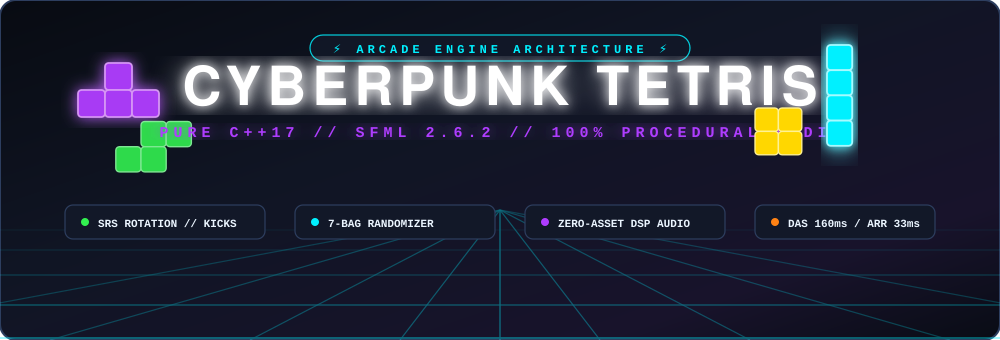
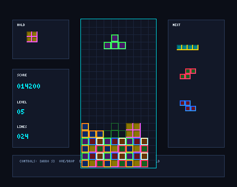

<p align="center">
  
</p>

<p align="center">
  <a href="https://github.com/thedreadlorddeath/Tetris">
    
  </a>
</p>

<p align="center">
  
  
  
  
  
  
</p>

<p align="center">
  
</p>

```
┌──────────────────────────────────────────────────────────────────────────────────┐
│  SYSTEM STATUS: ONLINE              CYBERDECK CORE: C++17 / SFML 2.6.2          │
│  MATRIX: 10 x 20 PLAYFIELD          DISPLAY: 960 x 760 @ 60 FPS V-SYNC          │
│  ROTATION: SRS GUIDELINE            AUDIO ENGINE: 16-VOICE POLYPHONIC SYNTH     │
│  RANDOMIZER: 7-BAG GENERATOR        VFX: VELOCITY SPARKS & HAPTIC SHAKE         │
└──────────────────────────────────────────────────────────────────────────────────┘
```

---

## 🎮 Live Engine Gameplay Preview

<p align="center">
  
  <br>
  <em>⚡ <b>Live In-Engine Simulation:</b> Authentic SRS Wall Kicks, Projected Ghost Piece, Instant Hard Drop, Dynamic Line-Clear Sparks, Screen Shake & Quad "TETRIS!" Banner ⚡</em>
</p>

---

## ⚡ The Cyberpunk Arcade Vision

Step into a midnight Neo-Tokyo arcade cabinet. **Cyberpunk Neon Tetris** is a modern reimagining of the iconic falling-block puzzle, built entirely from scratch in **C++17** using **SFML 2.6.2**. 

Engineered with hyper-responsive input handling, authentic guideline-level rotation physics, and an electrifying aesthetic:

* 🌌 **Deep Cyberpunk Atmosphere:** Deep midnight navy `#0B0E17` background with radiant luminous grids and neon-lit glass cards.
* 🔮 **Glossy 3D Neon Bevels:** Multi-tier edge shading with top-left specular highlights and bottom-right shadow depths for maximum arcade depth.
* 🚀 **Silky Frame Timing:** Sub-millisecond tick rates with 160ms DAS / 33ms ARR auto-repeat mechanics.
* 🎵 **Zero-Asset DSP Audio:** Complete synthesized soundscape generated in memory via math functions — no external `.wav` or `.ogg` sound files required!

---

## 🕹️ Guideline Engine Mechanics

### 🌀 Super Rotation System (SRS)
Faithfully implements the complete Super Rotation System wall-kick and floor-kick standard:
- Dedicated 5-test offset matrices for standard pieces ($J, L, S, T, Z$) and specialized 4×4 translation kicks for the long $I$-bar.
- Allows advanced competitive maneuvers including floor-kicks, wall-tucks, and tight-corner spins.

### 🎒 7-Bag Randomizer
- Guarantees true guideline fairness by shuffling all 7 pieces into a randomized pouch.
- Zero starvation droughts: you will never wait more than 12 pieces for an $I$-bar.

### ⏱️ Lock Delay & Move Resets
- Pieces enjoy a **0.5s lock delay** upon touching the stack, allowing clutch slides and last-millisecond rotations.
- Enforces a strict **15-reset maximum** per piece to prevent infinite stalling.

### 📊 Arcade Scoring Matrix

| Action | Formula | Level 1 | Level 10 |
| :--- | :--- | :---: | :---: |
| **Single Line** | `100 × Level` | `100` | `1,000` |
| **Double Clear** | `300 × Level` | `300` | `3,000` |
| **Triple Clear** | `500 × Level` | `500` | `5,000` |
| **⚡ Quad Tetris** | `800 × Level` *(Screen Flash + Fanfare)* | `800` | `8,000` |
| **Soft Drop** | `+1 pt / cell` | — | — |
| **Hard Drop** | `+2 pts / cell` | — | — |

---

## 🌌 Visual FX & Particle Dynamics

* **Ghost Projection:** Real-time projected landing footprint rendered with crisp neon contouring and translucent core.
* **Spark Burst Particle Engine:** Clearing lines discharges velocity-driven neon embers that drift, decelerate, and fade with alpha curves.
* **Camera Shake Impact:** Landing a 4-line Tetris clear triggers traumatic screen shake that shakes the camera and snaps back seamlessly.
* **Rolling Score Counter:** Scores don't just jump — they dynamically roll up in real-time, accompanied by persistent high score saving (`highscore.txt`).
* **Tactical HUD Deck:** Features a 3-piece Next Queue, Hold Chamber, Level indicator, Lines Cleared, and on-screen Controls Legend.

---

## 🔊 Mathematical In-Memory DSP Synthesizer

Forget missing sound asset errors. Every audio effect in the game is **synthesized purely in memory using mathematical formulas** via `sf::SoundBuffer` and played through a **16-channel polyphonic voice pool**:

```
 Sine Wave:     y(t) = A · sin(2π · f(t) · t)
 Frequency Mod: f(t) = f_start + (f_end - f_start) · (t / T)
 Chord Stack:   y(t) = ∑ A_k · sin(2π · f_k · t)
```

* **Move Chirp:** Frequency-swept micro-chirp (700 Hz → 900 Hz).
* **Rotate Blip:** Quick frequency pitch-sweep (400 Hz → 850 Hz) giving tactile rotation feedback.
* **Hard Drop Impact:** Low-frequency 80 Hz sub-bass punch with exponential volume decay.
* **Line Clear Chord:** Harmonic arpeggio stacking C5, E5, and G5 notes.
* **Quad Fanfare:** Triumphant multi-harmonic chord with vibrant modulations.
* **Game Over Sweep:** Descending pitch envelope (450 Hz → 70 Hz) with retro gritty distortion.

---

## 🎨 Chroma Matrix & Tetromino Palette

| Piece | Geometry | Neon Color | Hex Code | Visual Vibe |
| :---: | :---: | :--- | :---: | :--- |
| **I** | `[][][][]` | Electric Cyan | `#00F0FF` | High-voltage neon laser |
| **O** | `[][] / [][]` | Cyber Gold | `#FFD700` | Warm arcade coin glow |
| **T** | `[][][] / []` | Neon Violet | `#AF3CFF` | Synthwave purple haze |
| **S** | `[][] / [][]` | Acid Green | `#32F050` | Radioactive phosphor green |
| **Z** | `[][] / [][]` | Crimson Red | `#FF2D4B` | Digital alert crimson |
| **J** | `[] / [][][]` | Cobalt Blue | `#1E64FF` | Deep electric sapphire |
| **L** | `[][][] / []` | Solar Orange | `#FF8214` | Supercharged ember orange |

---

## 🕹️ Arcade Control Deck

<div align="center">

| Button | Keybind | Function |
| :---: | :---: | :--- |
| **LEFT / RIGHT** | <kbd>←</kbd> / <kbd>→</kbd> | Horizontal movement (DAS 160ms / ARR 33ms) |
| **SOFT DROP** | <kbd>↓</kbd> | Accelerated drop (`+1` point per cell) |
| **HARD DROP** | <kbd>Space</kbd> | Instant plunge & lock (`+2` points per cell) |
| **ROTATE CW** | <kbd>↑</kbd> / <kbd>X</kbd> | Rotate 90° Clockwise (SRS Wall Kicks) |
| **ROTATE CCW** | <kbd>Z</kbd> / <kbd>Ctrl</kbd> | Rotate 90° Counter-Clockwise (SRS Wall Kicks) |
| **HOLD PIECE** | <kbd>C</kbd> / <kbd>Shift</kbd> | Swap piece with Hold Chamber (once per turn) |
| **PAUSE** | <kbd>P</kbd> | Freeze matrix & toggle pause overlay |
| **RESTART** | <kbd>R</kbd> | Instant reset to fresh board |
| **MUTE** | <kbd>M</kbd> | Toggle audio synthesis |

</div>

---

## 🏗️ Project Anatomy

```text
Tetris/
├── CMakeLists.txt          # Automated FetchContent for SFML 2.6.2 & static compilation
├── .gitignore              # Ignores build dirs, binaries, and runtime artifacts
├── README.md               # Interactive Cyberpunk documentation
├── assets/
│   ├── arcade_banner.svg   # Neon architecture vector banner
│   └── gameplay.gif        # Live gameplay demonstration GIF
├── include/
│   ├── Config.hpp          # Dimensions, timings, colors, and game states
│   ├── Tetromino.hpp       # Piece geometries, SRS kick tables, 3D block renderer
│   ├── Board.hpp           # 10x20 matrix, collision solver, line clear effects
│   ├── PieceBag.hpp        # 7-bag randomizer piece distribution queue
│   ├── Particles.hpp       # Spark particle emitter & camera shake dynamics
│   ├── SoundManager.hpp    # DSP synthesizer & 16-voice polyphonic audio pool
│   └── Game.hpp            # Main game loop, state manager, HUD & event dispatcher
└── src/
    ├── main.cpp            # Application entry point
    ├── Game.cpp            # Input dispatch, DAS/ARR tick, render passes
    ├── Board.cpp           # Grid updates, ghost calculation, line resolution
    ├── Tetromino.cpp       # SRS kick implementation & bevel block rendering
    ├── PieceBag.cpp        # 7-bag shuffle algorithm
    ├── Particles.cpp       # Particle physics updates & camera offset math
    └── SoundManager.cpp    # Procedural waveform DSP generation & buffer setup
```

---

## 🚀 Building & Running

### Prerequisites
* **C++17 Compiler** (GCC 9+, Clang 10+, or MSVC 2019+)
* **CMake 3.20+**
* An internet connection during the first configure step (CMake will automatically fetch SFML 2.6.2)

### 💻 Windows (MinGW / GCC)
```powershell
# 1. Configure the build
cmake -B build -G "MinGW Makefiles" -DCMAKE_BUILD_TYPE=Release

# 2. Build the executable
cmake --build build -j

# 3. Launch and play
.\build\Tetris.exe
```

### 💻 Windows (Visual Studio / MSVC)
```powershell
cmake -B build -G "Visual Studio 17 2022" -A x64
cmake --build build --config Release
.\build\Release\Tetris.exe
```

### 🐧 Linux (Debian / Ubuntu / Fedora / Arch)
```bash
# Install SFML development dependencies
sudo apt-get update && sudo apt-get install -y \
    libxrandr-dev libxcursor-dev libudev-dev \
    libopenal-dev libflac-dev libvorbis-dev

# Build & Run
cmake -B build -DCMAKE_BUILD_TYPE=Release
cmake --build build -j$(nproc)
./build/Tetris
```

### 📱 Android Mobile Edition (Production APK)

Ready-to-install, verified, crash-free APK targeting **Android 9.0 (API 21) through Android 14/15 (API 34)** with native 64-bit `arm64-v8a` performance:

* 📦 **Direct APK:** [`android/Tetris.apk`](android/Tetris.apk)
* ⚡ **ABIs Included:** `arm64-v8a` (modern 64-bit Snapdragon/Tensor/Dimensity), `armeabi-v7a`, `x86_64` (emulator)
* 🎮 **Controls:** Responsive on-screen Neon Touch D-Pad (Left, Right, Rotate CW/CCW, Soft Drop, Hard Drop, Hold, Pause, Restart, Mute)
* 📐 **Display:** Adaptive portrait 960×1600 `sf::View` with letterbox aspect-ratio preservation
* 🛡️ **Hardened Packaging:** 
  - `resources.arsc` stored uncompressed (`ZIP_STORED`) on a 4-byte boundary
  - Full 4-byte / 16-KB page-alignment via `zipalign`
  - Signed with dedicated release keystore via **APK Signature Schemes v1, v2, and v3**

```powershell
# Rebuild & re-sign APK from source anytime:
.\build_and_sign.ps1

# Run the 5-step pre-delivery verification suite:
.\verify_apk.ps1
```

---

## ⚙️ Cyberdeck Tweaks & Customization

All core gameplay constants are centralized in [`include/Config.hpp`](include/Config.hpp) for effortless modding:

```cpp
// Customize your arcade experience
constexpr float LOCK_DELAY = 0.5f;          // Lock delay window (seconds)
constexpr int   MAX_LOCK_RESETS = 15;       // Move resets before lock
constexpr float DAS_DELAY = 0.160f;         // Delayed Auto Shift trigger
constexpr float ARR_INTERVAL = 0.033f;      // Auto Repeat Rate frequency (~30Hz)
constexpr int   BLOCK_SIZE = 32;            // Grid block dimensions in pixels
```

---

## 📜 License

Distributed under the **MIT License**. Created by [The Dreadlord](https://github.com/thedreadlorddeath).

<p align="center">
  
</p>
